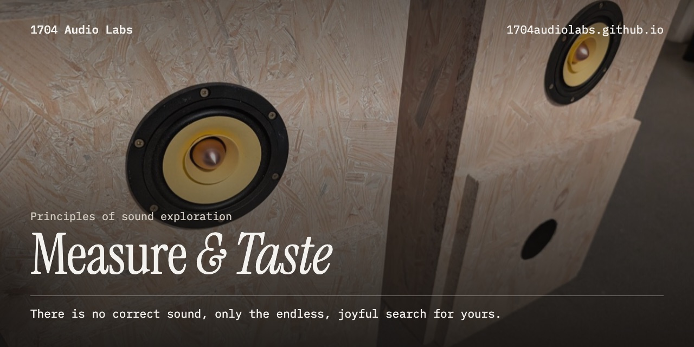
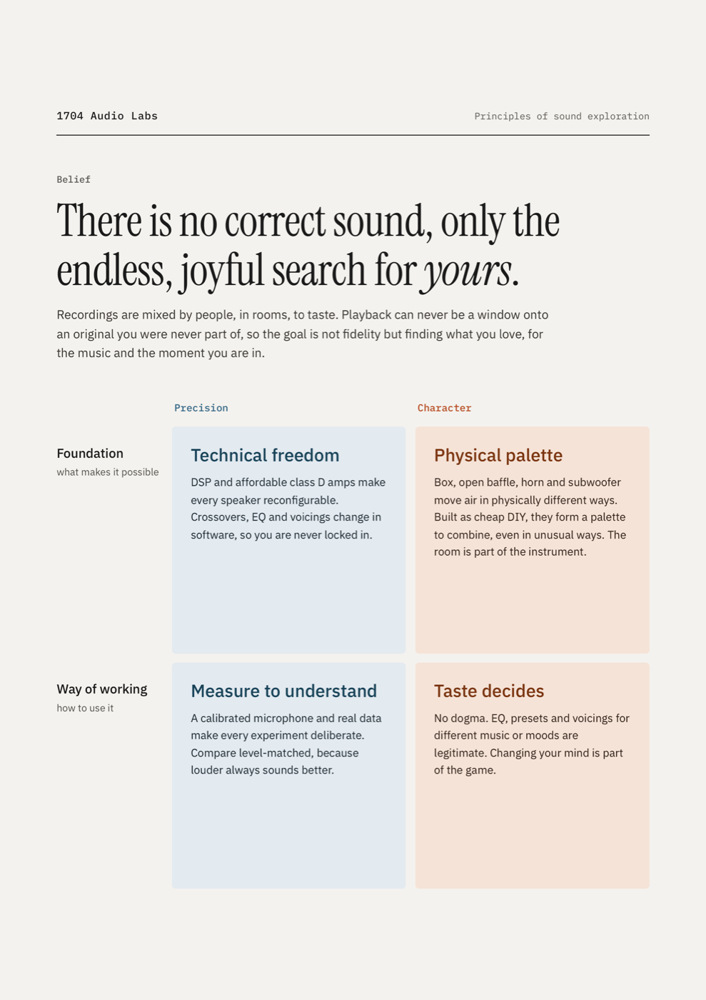
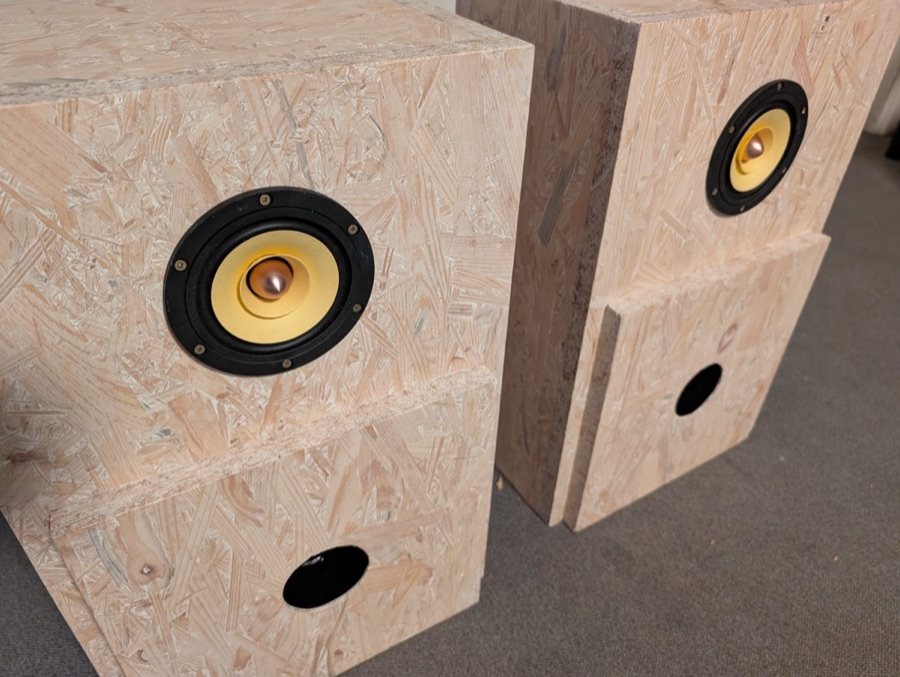
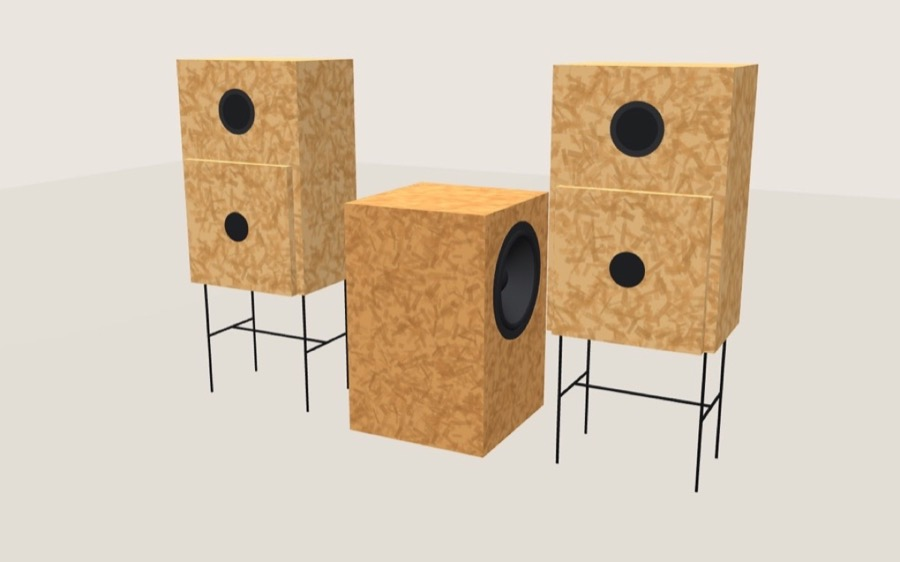

### There is no correct sound, only the endless, joyful search for *yours*.

Recordings are mixed by people, in rooms, to taste. Playback can never be a window onto an original
you were never part of, so the goal is not fidelity but finding what you love, for the music and the
moment you are in.

**1704 Audio Labs** builds DIY loudspeakers from affordable parts, measures them to understand, and
voices them to taste. Every plan, drawing, script and measurement is free to rebuild.

## Principles of sound exploration

|  | **Precision** | **Character** |
| --- | --- | --- |
| **Foundation** what makes it possible | **Technical freedom** DSP and affordable class D amps make every speaker reconfigurable. Crossovers, EQ and voicings change in software, so you are never locked in. | **Physical palette** Box, open baffle, horn and subwoofer move air in physically different ways. Built as cheap DIY, they form a palette to combine, even in unusual ways. The room is part of the instrument. |
| **Way of working** how to use it | **Measure to understand** A calibrated microphone and real data make every experiment deliberate. Compare level-matched, because louder always sounds better. | **Taste decides** No dogma. EQ, presets and voicings for different music or moods are legitimate. Changing your mind is part of the game. |

 
The poster as a page, ready to print: <a href="https://1704audiolabs.github.io/">1704audiolabs.github.io</a>

## On a budget

**Good sound is not a price class.** Every project here starts from parts anyone can buy: one sheet
of OSB from the DIY store, a drain pipe, an affordable full-range driver, a class D amp. Cheap enough
to build more than one, to cut it open, to try the unusual, and to spend the effort where it decides:
on measuring, and on listening.

## Projects

<table>
<tr>
<td width="50%" valign="top">

 01 · after Jean Hiraga, 1983
<h3>Le Petit</h3>
Jean Hiraga's Le Petit from one sheet of OSB with an Aiyima 4″ driver: <b>flat within ±1 dB from 55 to 150 Hz</b>, tuned by measurement, one change at a time.
  
<a href="https://1704audiolabs.github.io/le-petit/">Website</a> ·
<a href="https://1704audiolabs.github.io/le-petit/one-sheet/">One-sheet</a> ·
<a href="https://github.com/1704audiolabs/le-petit">Repository</a>
</td>
<td width="50%" valign="top">

 02 · companion to Le Petit
<h3>Le Petit Sub</h3>
Le Petit's bigger twin: <b>a sealed subwoofer with two opposed 10″ drivers</b>, built from one sheet of OSB with exactly Le Petit's front.
  
<a href="https://1704audiolabs.github.io/le-petit-sub/">Website</a> ·
<a href="https://1704audiolabs.github.io/le-petit-sub/3d-model/">3D model</a> ·
<a href="https://1704audiolabs.github.io/le-petit-sub/one-sheet/">One-sheet</a> ·
<a href="https://github.com/1704audiolabs/le-petit-sub">Repository</a>
</td>
</tr>
</table>

## Free to rebuild

Documentation, drawings, photos and data under **CC BY-SA 4.0**, plan scripts under **MIT**. Questions
and build reports are welcome in [Le Petit's discussions](https://github.com/1704audiolabs/le-petit/discussions).

1704 Audio Labs · Measure & Taste · by rich1704
